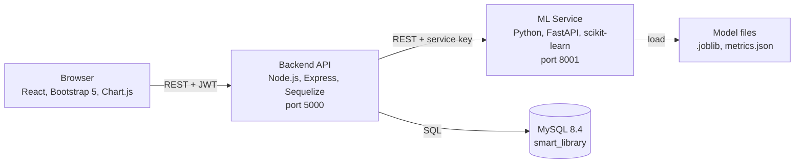
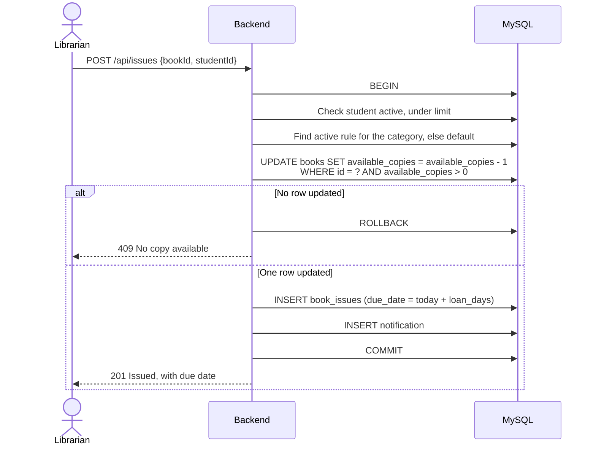
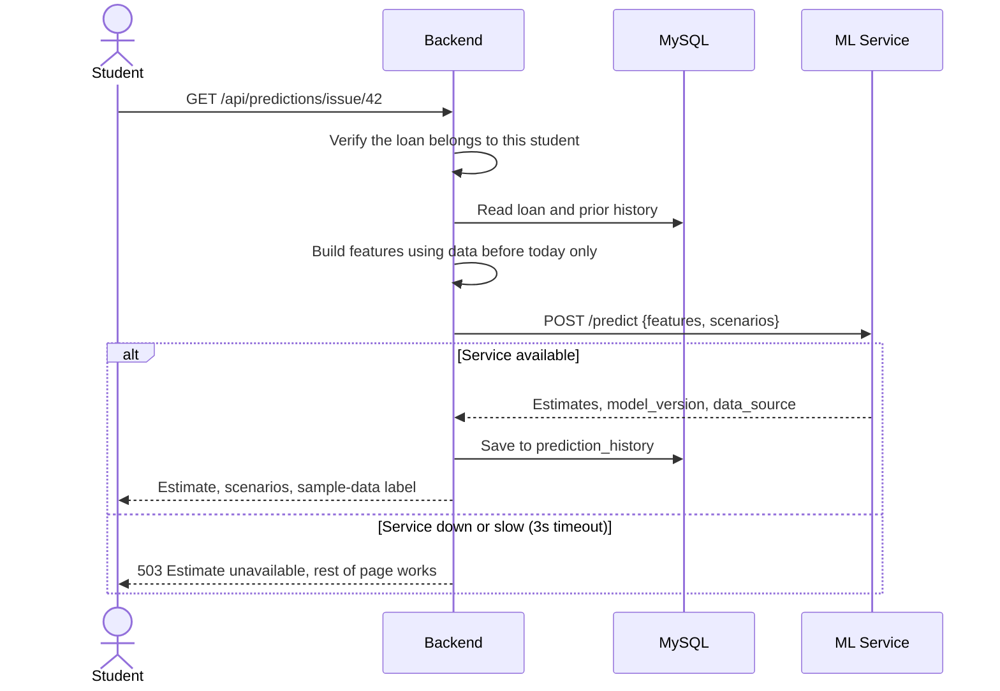

# 2. System Architecture

## 2.1 Overview

The system has three independently running applications and one database (a three-tier design plus a separate ML service).



| Part | Responsible for | Never does |
|---|---|---|
| React frontend | Screens, forms, charts | Business rules, or calling the ML service directly |
| Express backend | Authentication, permissions, all business rules, all database access | Machine-learning logic |
| FastAPI ML service | Loading the model, returning estimates and metrics | Touching MySQL or calculating actual fines |
| MySQL | Permanent data and integrity constraints | Storing the fine formula |

## 2.2 Key technical decisions

| Decision | Why |
|---|---|
| **Sequelize** (on the mysql2 driver) is the only database access layer | One consistent approach. Models and transactions are easy to explain, and queries are parameterised, which blocks SQL injection. Complex reports use `sequelize.query` with bound parameters |
| **`database/schema.sql` is the source of truth** | Constraints such as generated columns and CHECKs are clearest in SQL. Sequelize models map to these tables, and `sync()` is never used |
| **ML service has no database access** | The backend computes the features and sends them over, so the service stays stateless and can be replaced without touching anything else |
| **ML service is private** | It binds to `127.0.0.1` and requires an `X-Service-Key` header. The browser only ever talks to the backend, which enforces who may see which loan |
| **Dates use the MySQL `DATE` type** | Loans work in whole days. Avoiding timestamps prevents off-by-one errors from time zones |
| **Stateless JWT in an `Authorization` header** | Simple to explain and needs no session storage. Expiry is 8 hours; the user logs in again after that |

## 2.3 Backend structure

Requests flow in one direction, which keeps each layer easy to test and explain:

```text
route -> auth middleware -> role middleware -> validation -> controller -> service -> Sequelize model -> MySQL
```

| Folder | Holds |
|---|---|
| `routes/` | URL to controller mapping, with the allowed roles declared on each route |
| `middleware/` | JWT check, role check, validation result handler, central error handler |
| `controllers/` | Read the request, call a service, send the response |
| `services/` | Business rules: `loanService`, `fineService`, `predictionService`, `reminderService` |
| `models/` | Sequelize table definitions and relationships |
| `utils/` | Date helpers, API error class, PDF and Excel builders |
| `config/` | Database connection, environment loading |

`fineService` is the **only** place the fine formula exists.

## 2.4 Key flows

### Issuing a book



The conditional `UPDATE` is what stops two librarians issuing the last copy at the same moment: the database applies the updates one at a time, so only one can succeed.

### Returning a book

Runs in one transaction:

1. Lock the loan row and reject it if it is already returned.
2. Insert `book_returns` and set the loan to `RETURNED`.
3. Add 1 to `available_copies`.
4. Calculate the fine using the rule stored on the loan.
5. If the fine is above zero, insert `fines`.
6. Add a notification and commit.

### Getting an ML estimate



## 2.5 REST API plan

All routes start with `/api`. All except login need a valid JWT. Lists support `page`, `limit`, `search` and relevant filters.

| Area | Method and path | Roles |
|---|---|---|
| Auth | `POST /auth/login` | Public |
| | `GET /auth/me`, `PUT /auth/profile`, `PUT /auth/password` | All |
| Students | `GET /students`, `GET /students/:id` | Admin, Librarian |
| | `POST /students`, `PUT /students/:id`, `PATCH /students/:id/status` | Admin |
| Librarians | `GET`, `POST /librarians`; `PUT /librarians/:id`; `PATCH /librarians/:id/status` | Admin |
| Books | `GET /books`, `GET /books/:id` | All |
| | `POST /books`, `PUT /books/:id`, `PATCH /books/:id/status` | Admin, Librarian |
| Categories, authors | `GET /categories`, `GET /authors` | All |
| | `POST`, `PUT`, `DELETE` on the same resources | Admin |
| Issues | `GET /issues`, `POST /issues`, `GET /issues/overdue` | Admin, Librarian |
| | `GET /issues/mine` | Student |
| Returns | `POST /returns` | Admin, Librarian |
| Fine rules | `GET /fine-rules` | Admin, Librarian |
| | `POST /fine-rules` (replaces the active rule for that scope) | Admin |
| Fines | `GET /fines`, `POST /fines/:id/waive` | Admin, Librarian |
| | `GET /fines/mine` | Student |
| Payments | `POST /payments`, `GET /payments` | Admin, Librarian |
| Notifications | `GET /notifications`, `PATCH /notifications/:id/read`, `PATCH /notifications/read-all` | All |
| Predictions | `GET /predictions/issue/:issueId` | All, students own loans only |
| | `GET /predictions/history`, `GET /predictions/comparison`, `GET /predictions/metrics` | Admin |
| Dashboards | `GET /dashboard/admin`, `/librarian`, `/student` | Matching role |
| Reports | `GET /reports/:type?format=pdf\|xlsx` | Admin, Librarian |

**ML service routes (internal):** `POST /predict`, `GET /metrics`, `GET /health`.

**Errors** always use one shape, with `details` present for validation errors:

```json
{ "success": false, "message": "No copy available", "details": [] }
```

## 2.6 Frontend plan

| Area | Pages |
|---|---|
| Public | Login |
| Admin | Dashboard, Students, Librarians, Books, Categories, Authors, Issues, Returns, Overdue, Fine Rules, Fines and Payments, ML Reports, Reports, Notifications, Profile |
| Librarian | Dashboard, Issue Book, Return Book, Books, Overdue, Students and History, Fines and Payments, Reports, Notifications, Profile |
| Student | Dashboard, Search Books, My Loans (with fine estimate), History, My Fines, Notifications, Profile |

- `layouts/` holds one `DashboardLayout` (sidebar and top bar) used by all roles, with menu items chosen by role.
- `context/AuthContext` holds the logged-in user. `ProtectedRoute` checks login and role.
- `services/api.js` is one Axios instance that attaches the JWT and logs the user out on a 401.
- Hiding a menu item is only a convenience. The real permission check is always on the server.

## 2.7 Security design

| Threat | Protection |
|---|---|
| Stolen passwords | bcrypt with cost 10; hashes are never returned by the API |
| SQL injection | Sequelize parameterised queries only; sort columns come from a fixed allow-list |
| Broken access control | Role middleware on each route, plus an ownership check so a student cannot read another student's loan by changing an ID |
| Invalid input | `express-validator` on each write route |
| Brute-force login | Rate limit on the login route (50 tries per 15 minutes) |
| Exposed secrets | `.env` files are git-ignored; `.env.example` files are committed |
| Leaked internals | Central error handler; stack traces are logged and never sent to clients |

## 2.8 Folder structure

```text
library-management-system/
├── frontend/src/      components, pages, layouts, services, context, hooks, assets
├── backend/           config, controllers, middleware, models, routes, services, utils
├── ml-service/        app, models, datasets, training
├── database/          schema.sql, seed.sql, verify.sql
├── setup.bat          one-time database and settings setup
├── start.bat          starts all three services
└── documentation/     project documents
```

## 2.9 Viva notes

**Why a separate ML service instead of running Python from Node?** Python has the ML libraries. A separate service can be restarted, retrained or scaled alone, and a failure there cannot crash the library system.

**What happens if two librarians issue the last copy at once?** Both run a conditional `UPDATE`. InnoDB's row lock serialises them, so the first succeeds and the second updates zero rows and gets a 409 error.

**Why check roles on the server if the UI hides the buttons?** Anyone can call an API directly with a tool like Postman, so the UI is not a security boundary.

**Is the JWT stored in the database?** No. It is signed with a secret, so the server verifies the signature without a lookup.
