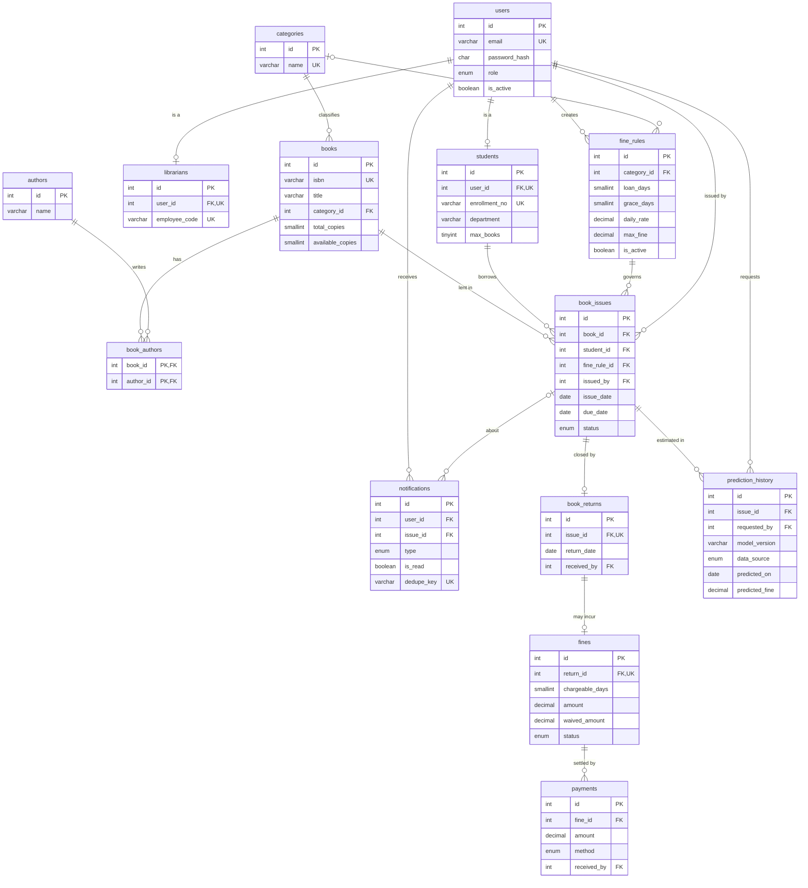

# 3. Database Design

**Engine:** MySQL (tested on 8.4.6 and 26.10), InnoDB, utf8mb4. **Files:** [schema.sql](../database/schema.sql), [seed.sql](../database/seed.sql), [verify.sql](../database/verify.sql).

## 3.1 ER diagram

## 3.2 Table summary

| Table | Purpose | Relationship highlights |
|---|---|---|
| `users` | Login and common details for all roles | Parent of `students`, `librarians` |
| `students` | Academic details and borrowing limit | 1:1 with `users` |
| `librarians` | Staff details | 1:1 with `users` |
| `categories` | Book classification | 1:N with `books` |
| `authors` | Author records | M:N with `books` |
| `books` | Catalogue and copy counts | N:1 with `categories` |
| `book_authors` | Junction for the M:N link | Composite primary key |
| `fine_rules` | Loan period, grace days, rate, cap | Optional category override |
| `book_issues` | One row per loan | Links book, student, rule and issuing user |
| `book_returns` | Return event | 1:0..1 with `book_issues` |
| `fines` | Actual fine | 1:0..1 with `book_returns` |
| `payments` | Instalments | N:1 with `fines` |
| `notifications` | In-app messages | N:1 with `users`, optional loan link |
| `prediction_history` | Estimates and their inputs | N:1 with `book_issues` |

Full column definitions, with comments, are in [schema.sql](../database/schema.sql).

## 3.3 Normalisation

**1NF, atomic values:** several authors would break this in a single column, so `book_authors` exists.

**2NF, no partial dependency:** the only composite key is in `book_authors`, and that table has no non-key columns.

**3NF, no transitive dependency:**

- `fines` has no `student_id`. The student is reached through return, then loan, then student.
- `book_issues` has no book title or student name.
- Paid amount is not stored. It is the sum of `payments`, shown by `v_fine_ledger`.
- "Overdue" is not stored. It is derived from `due_date` and today's date.

**Deliberate exceptions, and why:**

| Stored value | Could be derived, but | Protection |
|---|---|---|
| `books.available_copies` | Would need an aggregate query on every search | Changed only in issue and return transactions; checked by `verify.sql` |
| `fines.late_days`, `chargeable_days`, `daily_rate` | Are an audit record of how the fine was reached | Written once at return |
| Feature columns in `prediction_history` | Recalculating later would use newer data and give different values | Written once at prediction time |

## 3.4 Guarantees made by the database itself

These hold even if application code has a bug.

| Rule | How it is enforced |
|---|---|
| One active rule per category, one default | Unique index on generated column `active_scope` |
| A student cannot hold the same title twice at once, but can re-borrow it later | Unique index on `(student_id, book_id, open_loan)`, where `open_loan` is NULL once returned |
| A loan is returned once and fined once | Unique `issue_id`, unique `return_id` |
| Available copies never exceed total, and never drop below zero | CHECK constraint and `UNSIGNED` column |
| Due date is not before issue date | CHECK constraint |
| Waiver cannot exceed the fine; payments and fines are above zero | CHECK constraints |
| Books and users with history cannot be deleted | Foreign keys with the default RESTRICT behaviour; `is_active` is used instead |
| The daily job cannot send the same reminder twice | Unique `dedupe_key` |

**The generated-column technique:** MySQL has no "unique only where active" index. But a unique index allows many NULLs, so a generated column holding a value only for active rows gives the same effect.

## 3.5 Index plan

| Index | Serves |
|---|---|
| `book_issues (status, due_date)` | Overdue list, reminder job |
| `book_issues (student_id, status)` | Student's current loans, limit check |
| `book_issues (issue_date)` | Date-range reports |
| `books (is_active, available_copies)` | Available-books filter |
| `notifications (user_id, is_read, created_at)` | Inbox and unread count |
| `payments (paid_at)`, `book_returns (return_date)` | Revenue and return reports |
| `fines (status)` | Pending fines |

## 3.6 Views

| View | Gives |
|---|---|
| `v_loan_status` | Every loan with live state: `ACTIVE`, `DUE_SOON` (within 3 days), `OVERDUE` or `RETURNED` |
| `v_fine_ledger` | Every fine with paid amount, balance and student |
| `v_prediction_vs_actual` | Earliest prediction of each returned loan beside its actual fine. A loan returned with no fine counts as an actual fine of 0 |

The fine formula is deliberately not in any view, so it exists only in the backend `fineService`.

## 3.7 Sample data

| Item | Count |
|---|---|
| Users | 1 admin, 2 librarians, 6 students |
| Books | 16 titles in 6 categories, 22 authors |
| Fine rules | Default and Reference override |
| Loans | 11 returned, 7 open (3 active, 2 due soon, 2 overdue) |
| Fines | 6: paid, partly paid, unpaid and waived |

Dates are relative to the load date, so the demo always contains current overdue and due-soon loans. Names, phone numbers and ISBNs are invented placeholders. `prediction_history` starts empty on purpose, because fake predictions would distort the comparison report.

## 3.8 Test results (Phase 1)

Tested on MySQL 8.4.6. Schema, seed and integrity checks were also run on MySQL 26.10.

| Test | Result |
|---|---|
| `schema.sql` runs, and runs a second time without errors | Pass |
| `seed.sql` loads | Pass |
| 14 tables and 3 views created | Pass |
| 9 integrity checks in `verify.sql` | Pass, 0 problems each |
| Derived states: 3 active, 2 due soon, 2 overdue, 11 returned | Pass |
| Fine ledger balances, including partial payment and waiver | Pass |
| 10 invalid changes rejected by constraints | Pass |
| 2 valid edge cases accepted (inactive rule beside an active one, re-borrowing a returned book) | Pass |

## 3.9 Viva notes

**Why separate `users` and `students`?** Login data applies to everyone, academic data only to students. One table would leave many empty columns for staff.

**Why is `fine_rule_id` on the loan?** It fixes the terms at issue time, so later rule changes cannot alter what a student agreed to.

**Why link `fines` to `book_returns` and not to the student?** Linking to the student would duplicate information already reachable through the loan, which breaks 3NF. It also means a fine cannot exist without a return.

**Why use `DECIMAL` for money?** `FLOAT` stores approximations, so rupee amounts could drift. `DECIMAL` is exact.

**Why soft delete?** Deleting a student would destroy loan and fine records needed for reports and for ML training.
