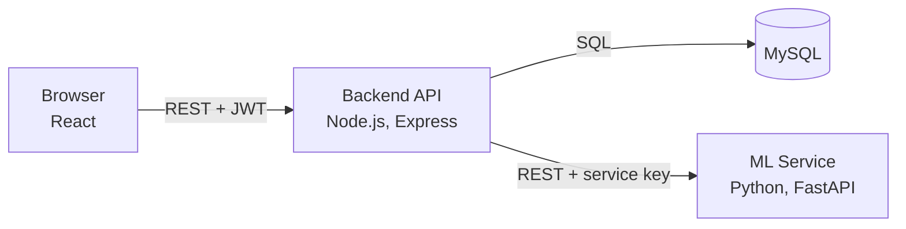
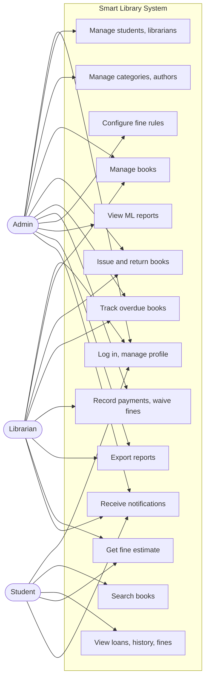
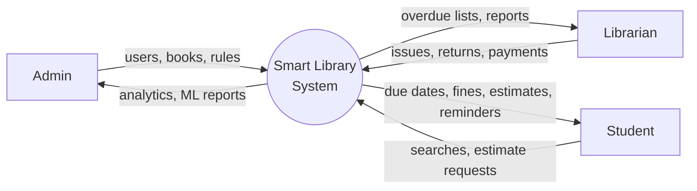
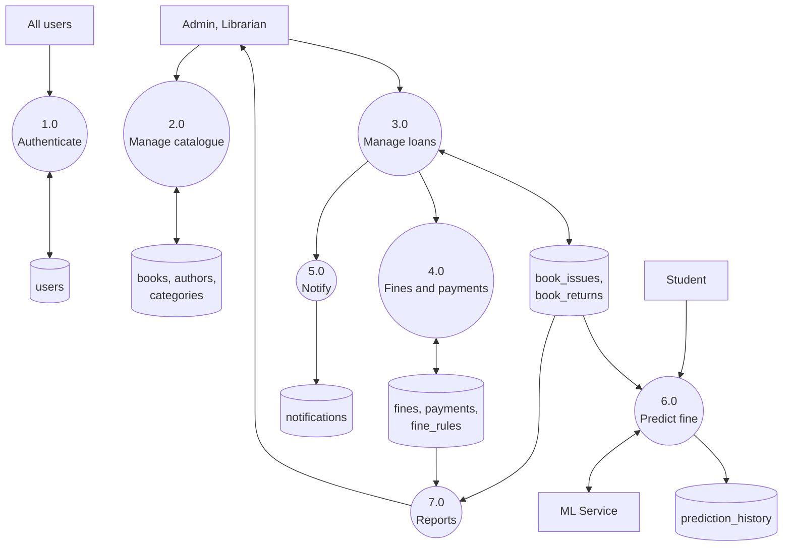
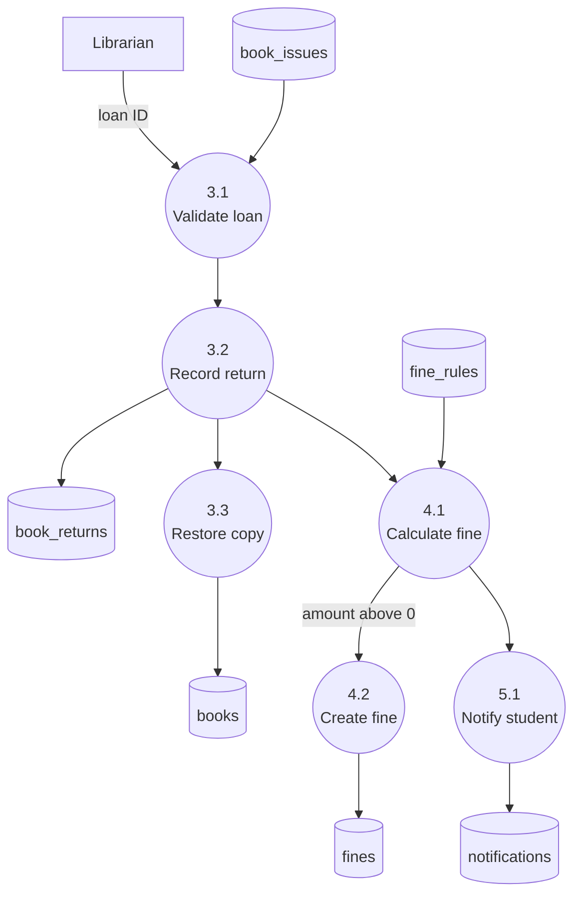
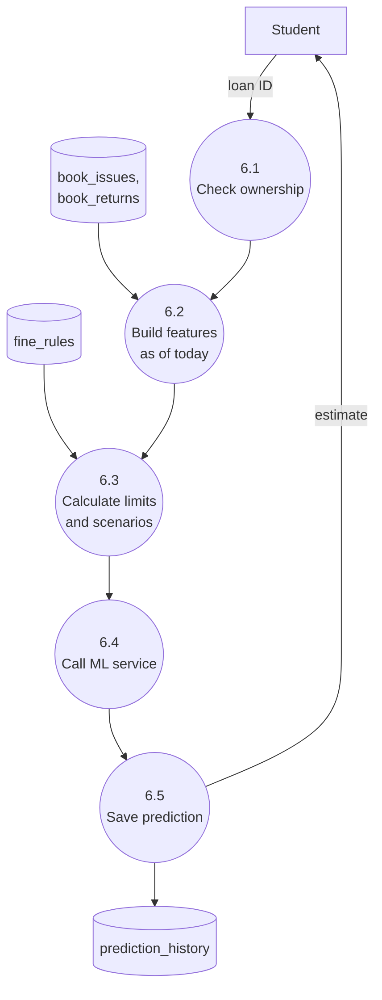

# Smart Library Management System with Fine Prediction Using Machine Learning

**MCA Final-Year Project Report**

Fill in before submission: student name, enrolment number, guide name, college, university and academic year.

---

## 1. Abstract

Library fines usually surprise students, because a fine becomes visible only when a book is returned. Staff also spend time tracking overdue books by hand. This project is a web-based library management system that automates issuing, returning, due dates, rule-based fines, payments, notifications and reports for three roles: Admin, Librarian and Student.

Its distinguishing feature is a separate machine-learning service that estimates the fine a student is likely to pay on a book still on loan. A Random Forest Regressor was compared with Linear Regression on synthetic loan data, using a time-based train/test split that prevents data leakage. On unseen test loans, Random Forest achieved an MAE of ₹15.15 and an R² of 0.537, against ₹17.38 and 0.411 for Linear Regression. Actual fines always come from the library's configured rules; the model only gives advance estimates. The system uses React, Node.js, Express, MySQL and a Python FastAPI service.

**Keywords:** library management, fine prediction, Random Forest, regression, MERN-style architecture, MySQL, FastAPI.

## 2. Introduction

A college library lends books for a fixed period and charges a fine for late return. Done manually or with basic software, this creates repetitive work and gives students little warning. Modern web technology can automate the process, and machine learning can use borrowing history to warn students early.

This project combines the two. It is a complete library system, plus an advisory estimate shown while a student can still act on it.

## 3. Problem Statement

1. Issue, return and fine records kept by hand are slow and error-prone.
2. Students cannot easily see due dates or what a delay will cost.
3. Staff have no quick view of overdue books or pending fines.
4. Management lacks reports on borrowing patterns and fine collection.
5. Existing systems calculate a fine only after it has already happened.

## 4. Objectives

1. Automate the complete loan cycle with role-based access.
2. Calculate due dates and fines automatically from configurable rules.
3. Record full and partial fine payments and waivers.
4. Send due-date, overdue, fine and payment notifications.
5. Provide dashboards, analytics, and PDF and Excel reports.
6. Train and evaluate an ML model that estimates fines on current loans.
7. Keep actual fines and predicted fines strictly separate.

## 5. Existing System

| Limitation | Effect |
|---|---|
| Paper registers or simple desktop software | Slow search, data entry errors |
| Fine worked out at the counter | Inconsistent, and known only at return |
| No reminders | More overdue books |
| No analytics | Decisions based on guesswork |
| No prediction | Students cannot act early |

## 6. Proposed System

- Web application with separate Admin, Librarian and Student dashboards.
- Automatic due dates and rule-based fines, with rules versioned so that a change never alters existing loans.
- Live overdue status and accrued fine display.
- Database constraints that protect key rules even if application code has a bug.
- ML fine estimate, with exact rule-based figures shown beside it for different return delays.
- The library keeps working if the ML service is unavailable.

## 7. Feasibility Study

| Type | Finding |
|---|---|
| Technical | All tools are mature, free and well documented. The system ran end to end on a Windows 11 PC |
| Economic | Open-source software only; no licence cost |
| Operational | Browser-based, with role-specific screens that need little training |
| Schedule | Divided into seven phases, each tested before the next |
| Legal and ethical | Passwords are hashed. Predictions are advisory and never affect a charge |

## 8. Software Requirements

### Software

| Item | Used |
|---|---|
| Operating system | Windows 11 |
| Frontend | React 19, Bootstrap 5, Axios, Chart.js, Vite |
| Backend | Node.js 24, Express 5, Sequelize 6, mysql2, JWT, bcrypt |
| Database | MySQL Community Server (tested on 8.4.6 and 26.10) |
| ML | Python 3.14, Pandas, NumPy, scikit-learn, Joblib, FastAPI, Uvicorn |
| Editor | Visual Studio Code |

### Minimum hardware

Dual-core processor, 8 GB RAM, 5 GB free disk space.

### Functional and non-functional requirements

See [01-requirements-analysis.md](01-requirements-analysis.md).

## 9. System Architecture

Three independent applications share one database. The browser talks only to the backend, and only the backend talks to the ML service. Details are in [02-system-architecture.md](02-system-architecture.md).

## 10. Use Case Diagram

## 11. Data Flow Diagrams

### DFD Level 0 (context)

### DFD Level 1

### DFD Level 2: Process 3.0 and 4.0 (returning a book)

### DFD Level 2: Process 6.0 (predicting a fine)

## 12. ER Diagram and Database Design

The database has 14 normalised tables and 3 read-only views. The full ER diagram, normalisation, constraints and indexes are in [03-database-design.md](03-database-design.md), and the column-level definitions are in [schema.sql](../database/schema.sql).

| Table | Primary key | Main foreign keys |
|---|---|---|
| users | id | none |
| students | id | user_id |
| librarians | id | user_id |
| categories | id | none |
| authors | id | none |
| books | id | category_id |
| book_authors | book_id + author_id | book_id, author_id |
| fine_rules | id | category_id, created_by |
| book_issues | id | book_id, student_id, fine_rule_id, issued_by |
| book_returns | id | issue_id, received_by |
| fines | id | return_id, waived_by |
| payments | id | fine_id, received_by |
| notifications | id | user_id, issue_id |
| prediction_history | id | issue_id, requested_by |

## 13. ML Methodology

The full design is in [04-ml-design.md](04-ml-design.md).

1. **Data:** 19,988 synthetic loans for 500 simulated students over three years, clearly labelled as synthetic. Fines follow the same rules as the real system.
2. **Features:** days remaining, issue duration, previous late-return count, average late days, share of past loans returned late, book category and borrowing frequency.
3. **Target:** the fine charged at eventual return.
4. **Split:** by time. The 15,996 training loans were all returned before the cutoff; the 3,992 test loans were all issued after it.
5. **Tuning:** grid search with time-ordered cross-validation on the training set only.
6. **Models:** Random Forest Regressor and Linear Regression, plus a baseline that always guesses the average.
7. **Serving:** the trained pipeline is saved with Joblib and loaded by FastAPI. Estimates are limited by known facts: never below the fine already accrued, and never above the rule's maximum.

**Leakage prevented:** outcome fields are never inputs, history counts only loans returned before the prediction date, and preprocessing is fitted on training data only.

## 14. Implementation

| Module | Main files | Summary |
|---|---|---|
| Authentication | `controllers/authController.js`, `middleware/auth.js` | bcrypt login, JWT, role checks |
| Users | `controllers/peopleController.js` | Students and librarians, soft delete |
| Catalogue | `controllers/catalogController.js` | Books, authors, categories, search |
| Loans | `services/loanService.js` | Transactional issue and return |
| Fines | `services/fineService.js` | The only copy of the fine formula, payments, waivers |
| Prediction | `services/predictionService.js`, `ml-service/` | Features, FastAPI call, history |
| Notifications | `services/reminderService.js` | Daily job with duplicate protection |
| Reports | `controllers/reportController.js`, `utils/exporters.js` | PDF and Excel export |
| Frontend | `frontend/src/` | Three dashboards, charts, responsive layout |

Key implementation decisions:

- **Safe last-copy issue:** `UPDATE books SET available_copies = available_copies - 1 WHERE id = ? AND available_copies > 0`. Only one concurrent request can succeed.
- **Transactions:** issue, return and payment each succeed or fail as a whole.
- **Derived overdue status:** calculated from the due date, so it can never go stale.

Add screenshots of the login page, three dashboards, the issue and return page, the fine estimate popup and ML Reports to this section.

## 15. Testing

### Approach

| Level | Method | Result |
|---|---|---|
| Unit | Fine formula: grace period, rate, cap, early return | Pass |
| Database | 9 integrity checks, 12 constraint tests, on MySQL 8.4.6 | Pass |
| Database compatibility | Schema, seed and 9 integrity checks on MySQL 26.10 | Pass |
| API integration | 17 automated test groups against a real MySQL database | 17 of 17 pass |
| Browser | All 29 role and page combinations in Microsoft Edge, with no console or API errors | Pass |
| User flows | Issue, late return, payment and fine estimate through the real UI | Pass |
| Responsive | Student pages at 390 px phone width, with no sideways page scroll | Pass |

### Sample test cases

| ID | Test | Expected | Result |
|---|---|---|---|
| T1 | Wrong password | 401, generic message | Pass |
| T2 | Student opens `/api/students` | 403 | Pass |
| T3 | Student requests another student's loan estimate | 403 | Pass |
| T4 | Search text `' OR 1=1 --` | Treated as text, no results | Pass |
| T5 | Three staff issue the last copy together | Exactly one succeeds | Pass |
| T6 | Issue beyond the borrowing limit | 409 | Pass |
| T7 | Return 1 day late with 1 grace day | No fine | Pass |
| T8 | Return 6 days late (₹5/day, 1 grace day) | ₹25 fine | Pass |
| T9 | Return a book twice | 409 | Pass |
| T10 | Payment above the balance | 422 | Pass |
| T11 | Rule changed while a loan is open | Open loan keeps its old terms | Pass |
| T12 | Daily reminder job runs twice | No duplicates | Pass |
| T13 | ML service stopped | Estimate shows unavailable; library still works | Pass |
| T14 | ML service called without its key | 401 | Pass |
| T15 | Deactivated user uses an old token | 401 | Pass |

### Bugs found and fixed through testing

- A shared Sequelize column definition caused payments to fail.
- Database views behaved differently depending on the client that loaded them; the collation is now fixed in the schema.
- The MySQL 26.10 client rejected the original setup command, so setup now feeds files directly.

## 16. Results

### Model comparison on the unseen test set

| Model | MAE (₹) | MSE | RMSE (₹) | R² |
|---|---:|---:|---:|---:|
| **Random Forest** | **15.151** | **844.948** | **29.068** | **0.5371** |
| Linear Regression | 17.381 | 1074.822 | 32.784 | 0.4112 |
| Always guess the average | 25.034 | 1827.015 | 42.744 | -0.0009 |

- Random Forest had the lowest error, about 13% lower MAE than Linear Regression and 39% lower than guessing the average.
- It explained about 54% of the variation in fines. The remainder is largely genuine randomness in when a person returns a book.
- **Days remaining** was the most important feature (0.787), followed by the share of past loans returned late (0.057) and average late days (0.043).

**Limitation:** the data is synthetic, so these figures show how well the model recovers patterns built into the generator. They do not prove accuracy in a real library. The system's predicted-versus-actual report is designed to measure that once real loans build up.

## 17. Future Scope

1. Retrain on real library data.
2. Online payment gateway.
3. Email and SMS reminders.
4. Book reservations and loan renewals.
5. Lost and damaged book charges.
6. Barcode or RFID copy tracking.
7. Automatic retraining after a fine-rule change.
8. Book recommendations.

## 18. Conclusion

The project delivers a working library management system for three roles, with automatic due dates, rule-based fines, payments, notifications, analytics and exports. It also adds a separately deployed ML service that gives students an early estimate of a likely fine. On unseen synthetic data, Random Forest beat Linear Regression and a simple baseline. Keeping actual fines rule-based keeps charges exact and explainable, while ML adds what rules cannot: a forward-looking estimate based on behaviour.

## 19. References

1. L. Breiman, "Random Forests," *Machine Learning*, vol. 45, no. 1, pp. 5-32, 2001.
2. F. Pedregosa et al., "Scikit-learn: Machine Learning in Python," *Journal of Machine Learning Research*, vol. 12, pp. 2825-2830, 2011.
3. A. Silberschatz, H. F. Korth and S. Sudarshan, *Database System Concepts*, McGraw-Hill.
4. R. S. Pressman, *Software Engineering: A Practitioner's Approach*, McGraw-Hill.
5. React documentation, https://react.dev
6. Express documentation, https://expressjs.com
7. Sequelize documentation, https://sequelize.org
8. MySQL Reference Manual, https://dev.mysql.com/doc
9. FastAPI documentation, https://fastapi.tiangolo.com
10. scikit-learn documentation, https://scikit-learn.org
11. M. Jones, J. Bradley and N. Sakimura, "JSON Web Token (JWT)," RFC 7519, IETF, 2015.
